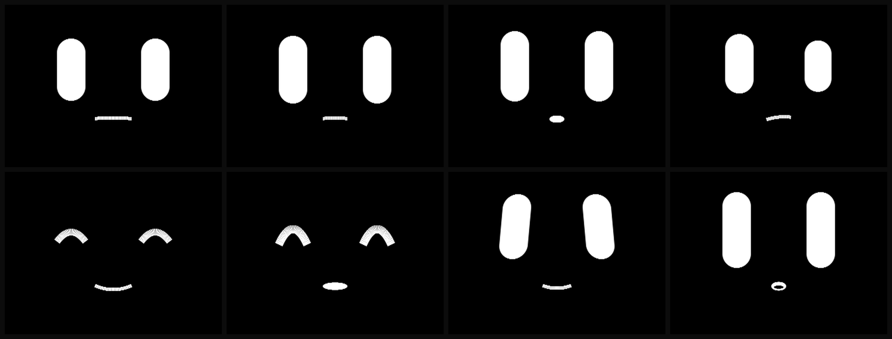

<div align="center">

# MindChan

### The body is open. The mind is not.

**A continuous expression engine for a 2-inch desktop robot — 71 named expressions,
3 colours, 16 ms per frame on an ESP32-S3, and the seven hardware bugs nobody wrote down.**

[-1f1f1f?style=flat-square)](https://docs.m5stack.com/en/StackChan)
[](https://www.espressif.com/en/products/socs/esp32-s3)
[](#the-numbers)
[](#why-not-spritesheets)
[](LICENSE)



<sub>Eight of the 71 named expressions — <code>neutral · attentive · curious · thinking ·
smile · delighted · proud · surprised</code>. Rendered from the same geometry constants the
firmware uses. Transition animation: <a href="assets/demo.gif"><code>assets/demo.gif</code></a>.</sub>

**English** · [简体中文](README.zh-CN.md)

</div>

---

## The claim

A face on a robot should not be a folder of PNGs with a state machine in front of it.

Every "expressive" desktop robot you can buy is doing the same thing: pick an image,
cross-fade, blink on a timer. It reads as *cute* for about ninety seconds and then reads as
*dead* forever, because nothing about it is continuous. You can always find the frames.

MindChan is a small continuous dynamical system instead:

```
PAD state ──▶ facial latent ──▶ shape parameters ──▶ per-pixel analytic AA
(3 floats)     (continuous)      (continuous)         (one dirty band per region)
```

Nothing is quantised into "frames", so the face can be **half-smiling**, can be
**interrupted mid-smile**, can **squint while it tilts**. Two transient impulses —
`kickS` (being touched) and `kickW` (a face appeared) — decay exponentially on top,
which is what makes it read as *reactive* rather than *scripted*.

71 named expressions come out of that continuum. They are **targets, not assets** — the
system interpolates between any two of them without a single transition animation.

---

## The numbers

| | |
|---|---|
| Full-dynamic frame (draw + blit) | **16–18 ms** |
| Render gate | **26 ms** → **~38 fps sustained** |
| Peak throughput (`bench`, no gate) | **54.3 fps** |
| Eye band / mouth band dirty area | **31,872 + 31,872 + 7,072 px** |
| Cost per blitted pixel | **0.38 µs** (SPI-bound) |
| Named expressions | **71** |
| Colours on screen | **3** |
| Spritesheets | **0** |
| Telemetry fields | **~50** at 10 Hz |

All measured on hardware. `rm` / `dms` / `bms` / `fr` / `lp` are reported live in every
telemetry packet, so you can re-run any of these claims yourself.

> One correction we keep having to make in public: the fields `lp` and `lpm` are named
> `*Us` in the firmware but are in **milliseconds**. If you see `lpm: 4050`, the device
> stalled for four seconds — that is not 4 ms. It took us an embarrassing amount of time
> to notice, and it is why bug #2 below exists.

---

## What this is

- An **expression engine**: analytic geometry, row-coverage antialiasing, three dirty
  bands, zero spritesheets.
- A **reflex layer**: gaze, blink, micro-saccade, touch response, physiological overlays
  (blush / sweat / tear) that are *event-driven*, not decorative.
- A **turn-taking loop**: it knows when it is speaking, when it is listening, and — the
  part almost nobody implements — **when it is waiting for you**.
- A **link contract** designed to survive WiFi, documented in [`docs/04-link-layer.md`](docs/04-link-layer.md).

## What this is not

- **Not a chatbot.** There is no language model in here, and there will not be one.
- **Not a firmware drop.** This repository is the **body layer** plus the field notes.
  The engine implementation stays private (see [*What's missing*](#whats-missing)).
- **Not a product.** It is a research instrument with a face on it.

---

## The seven bugs

Each of these cost hours, and none of them were written down anywhere. They are the actual
reason this repository exists. Full write-ups in
[`docs/02-the-seven-bugs.md`](docs/02-the-seven-bugs.md).

### 1. The camera will not init on I2C port 0

`ESP_ERR_INVALID_STATE (0x103)` / `err 262`, `sccb init err`. The GC0308 driver creates a
*second* I2C bus for SCCB if you give it a pin, and that collides with the one `M5Unified`
already owns. Passing `pin_sccb_sda = 12` makes it fail slower, not work.

```c
cfg.pin_sccb_sda  = -1;     // reuse the existing bus
cfg.pin_sccb_clk  = -1;
cfg.sccb_i2c_port = 1;      // <- port 0 fails, port 1 works
cfg.fb_count      = 1;
```

### 2. `Serial.write()` blocks for 2.5 seconds

Throughput sat at 0.6 Hz and we blamed WiFi, then ARP, then broadcast loss. The real cause:
USB-CDC `Serial.write()` **blocks when the TX buffer is full**, and if nothing is draining
the port it blocks for seconds. Testing with `cat` on the port masks it completely — which
is exactly what we were doing.

Worse, `Serial.availableForWrite()` **over-reports free space**, so guarding with it is not
enough. You have to disable blocking outright:

```c
Serial.setTxTimeoutMs(0);   // drop, never block
```

Measured: 78 packets sent → **3 replies** with the port unread; **97 → 97** with it read.

### 3. PSRAM is 8× slower than internal SRAM for pixel writes

Sprite buffers in PSRAM: 20 fps. Identical code with buffers in internal SRAM: 54 fps.
`dms 11.3 → 1.7 ms`, `bms 13.4 → 9.0 ms`. Per-pixel 16-bit writes to PSRAM on the S3 are the
bottleneck, and the fix is not a smaller sprite — it is `setBuffer()` onto static internal
RAM, which bypasses the allocator entirely.

Watch out for the trap: `setPsram(false)` does **not** mean internal RAM. It selects
`AllocationSource::Dma`, which silently fails to find a contiguous block after WiFi + camera
init. `createSprite()` returns null and nothing tells you.

### 4. Flicker is a structural problem, not a timing problem

"Flickering" faces are almost always clear-then-draw tearing. No amount of frame-rate tuning
fixes it. Draw into per-region off-screen buffers and blit **once per region** — the screen
never sees an intermediate state.

### 5. The device answered to whoever spoke last

Our host had two sockets talking to the device: a control console (own ephemeral port) and a
test script (bound to 20087). The device stored "the last sender" as its reply address, so
**unsolicited events went to the wrong socket**. Query replies looked perfect — they answer
the requester — so the bug presented as "the device is online but its events are missing",
which is nearly impossible to guess.

Fix: keep a small ring of recent endpoints and fan events out to all of them.

### 6. One packet per loop is a throughput ceiling of 27 pkt/s

`pollIncoming()` read exactly one datagram per main-loop iteration, and the loop is gated at
26 ms for rendering. So the whole device could receive **27 packets per second**. A
speech-envelope stream is 25 Hz by itself. Add a 5 Hz console poll and `end` / `bargein`
queue up for seconds — the symptom is *"it finished talking but its mouth is still open"*.

Fix: batch-drain up to 8 datagrams per tick, with an early break when the queue is empty.

### 7. Quantising alpha gave us concentric rings

A blush that should fade smoothly rendered as **seven hard concentric rings**. The cause was
not the gradient — it was `alpha >> 3` collapsing 256 levels into 32, which 16-bit RGB565
then collapsed further into ~7 distinguishable steps between black and the blush colour.
On a black background there is almost no red headroom.

Fix: keep alpha continuous and dither with a 4×4 Bayer matrix, with jitter amplitude
*proportional to intensity* — fixed-amplitude dither turns the soft edge into grey sand.

---

## Why not spritesheets?

Because the interesting expressions live **between** the ones you drew.

The face is one primitive — a stadium ("lens") for each eye, an arc for the mouth — with
independent upper/lower lid heights, mirror-capable tilt, and a quadratic-Bézier arc whose
sag is a live parameter. A hand-authored sprite atlas would need thousands of frames to
cover the same continuum, and would still snap.

Two consequences worth knowing if you build one of these:

- A quadratic Bézier at `t = 0.5` evaluates to `(p0 + 2·p1 + p2) / 4`, so the control-point
  offset you need is **twice** the visual sag you want.
- Transitioning between a lens and an arc must be **geometric**, not a fade: white at 50 %
  over black is grey, and grey over white reads as a double image. Vertical extent has to
  collapse as the square of the arc parameter `(1 − arc)²`, not linearly.

---

## Protocol

Two channels, deliberately different shapes:

| Channel | Rate | Direction | Shape |
|---|---|---|---|
| **State** | 10 Hz | device → host | continuous, lossy, idempotent |
| **Commands** | event | host → device | discrete, must not be lost |
| **Events** | event | device → host | unsolicited, fanned out to all active sinks |

State is polled (`q`), never pushed. That is backwards from the obvious design and it is why
the link is stable. Commands are idempotent and sent 2–3× because UDP over WiFi drops them.

A speech turn looks like this:

```
host → listen:8000          device enters Listening
host → say:happy:6000       device enters Speaking, sets the matching expression
host → v:<0..100>  @25 Hz   envelope from the actual audio being played
host → end                  device returns to Idle and *arms an expectation*
device → {"ev":"expect_miss","waited":6019,"lon":0.16,"miss":2}
```

That last line is the whole point. If you don't answer, it notices, and it gets lonelier.

Wire format, cue vocabulary and the servo safety contract (pitch clamped 50–850 raw on every
path, no exceptions) are in [`SPEC.md`](SPEC.md).

---

## Hardware reference

Everything below was read out of the BSP source, not guessed.

| | |
|---|---|
| Board | M5Stack StackChan `SKU:K151`, CoreS3 base |
| MCU | ESP32-S3 QFN56 v0.2, 2× LX7 @ 240 MHz, 16 MB flash, 8 MB PSRAM |
| Display | 320×240 IPS, natively landscape, rotation must be probed |
| Servos | 2× SCS0009 serial bus, UART1 @ 1 Mbps, TX=GPIO6 RX=GPIO7 |
| Servo range | yaw ID1 zero 460 ±1280, pitch ID2 zero 620; 1 step = 0.3125° |
| IO expander | PY32L020 @0x6F — pin0 = servo VM_EN, pin13 = RGB data |
| LEDs | 12× WS2812C |
| Touch | Si12T @0x68, 3 zones |
| IMU / power | BMI270 · INA226 @0x41 |
| NFC | ST25R3916 @0x50 (`M5Unit-NFC`) |
| Camera | GC0308, D0–D7 = 39/40/41/42/15/16/48/47, VSYNC 46, HREF 38, PCLK 45 |

Deeper notes in [`docs/01-hardware-notes.md`](docs/01-hardware-notes.md).
Toolchain: `esp32:esp32@3.3.12`, `M5Unified`, `M5GFX`, `M5StackChan` (BSP).

---

## What's missing

This repo is the **body**. The mind — the part that decides what to feel, remembers who you
are, and turns a week of interaction into a model of you — is not here and is not going to be.

That is not a licensing tease, it is a design position. A robot's aliveness is not in its
facial geometry; geometry is the cheapest, most copyable layer. What makes a companion feel
alive is **continuity**: the same face meaning different things on day 40 than on day 1,
because it now knows your Tuesday.

So we opened the part you can verify and kept the part that has to be earned.

What we *are* publishing, over time:

- [x] Expression taxonomy (71 names, semantics, target parameters)
- [x] Wire protocol, cue vocabulary, servo safety contract
- [x] Hardware and link-layer field notes — *seven bugs, all reproducible*
- [ ] Gaze controller (camera → look-at-point)
- [ ] Dual-mic direction-of-arrival — *"it turns when you call it"*
- [ ] Touch–affect calibration data (n=1, then n=36)
- [ ] The five measurable axes of aliveness and how we test them
- [ ] Reference renderer — *ships with the paper, not before*

If you are building the mind yourself and want a body that answers to it: open an issue with
what your architecture looks like. That conversation is the point of this repository.

---

## Prior art

Standing on: [m5stack/StackChan](https://github.com/m5stack/StackChan) ·
[StackChan-BSP](https://github.com/m5stack/StackChan-BSP) ·
[M5Unified](https://github.com/m5stack/M5Unified) ·
[LovyanGFX](https://github.com/lovyan03/LovyanGFX) ·
[SCServo](https://github.com/m5stack/SCServo).

## Licence

Apache-2.0 for code and specification. Documentation and the expression taxonomy are
CC BY-NC-SA 4.0 — see [`LICENSE-docs`](LICENSE-docs).
