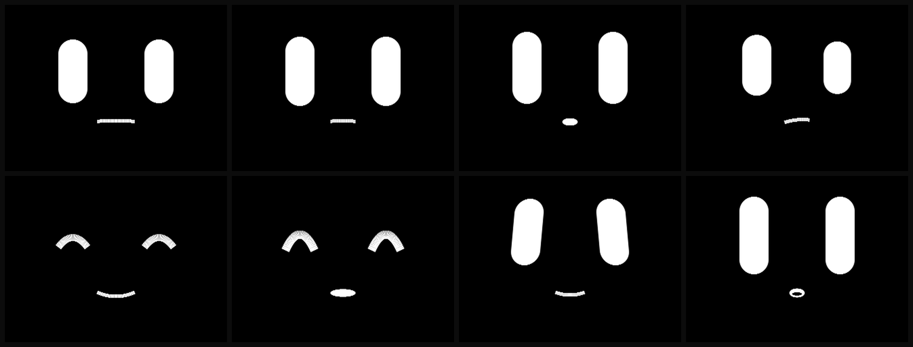

# MindChan · 中文说明

> **身体开放，心智保留。**

一块 2 寸桌面机器人的连续表情引擎。71 个具名表情、3 种颜色、ESP32-S3 上一帧 16 ms，
以及**七个人家没写下来过的硬件坑**。

English is the primary README: [`README.md`](README.md) — 那份更完整。本文是给中文读者的导览。

<p align="center"></p>

<sub>71 个具名表情中的 8 个：neutral · attentive · curious · thinking · smile · delighted · proud · surprised。
用固件同一套几何常量渲染。过渡动画见 <a href="assets/demo.gif"><code>assets/demo.gif</code></a>。</sub>

---

## 我们在主张什么

机器人脸上的表情，不该是一个装满 PNG 的文件夹加一台状态机。

市面上几乎所有"有表情"的桌面机器人都是这么做的：选图、淡入淡出、定时眨眼。前九十秒显得
**可爱**，之后就永远是**死的**——因为你能看见帧。你的视觉系统会在一分钟内把那些 PNG 一个个
分辨出来。

MindChan 做的是另一件事：一个小的**连续动力系统**。

```
PAD 状态 ──▶ 面部隐变量 ──▶ 形状参数 ──▶ 逐像素解析抗锯齿
（3 个浮点）  （连续）       （连续）      （每个区域一个脏带，一帧只贴一次）
```

没有任何东西被量化成"帧"，所以脸可以**半笑**，可以**笑到一半被打断**，可以**眯着眼歪头**。
两个瞬时脉冲——`kickS`（被摸到）和 `kickW`（有张脸出现了）——在它上面做指数衰减，
这才是"反应"而不是"播放"的来源。

71 个具名表情是**目标点，不是素材**。系统在任意两个之间插值，不需要一个过渡动画。

## 数字（都在硬件上实测，遥测里实时可见）

| | |
|---|---|
| 整帧（绘制 + 贴合） | **16–18 ms** |
| 渲染闸门 | **26 ms** → **约 38 fps 持续** |
| 峰值吞吐（`bench`，绕过闸门） | **54.3 fps** |
| 三块脏带面积 | **31,872 + 31,872 + 7,072 px** |
| 每个贴合像素成本 | **0.38 µs**（SPI 卡口） |
| 具名表情 | **71** |
| 屏幕上的颜色 | **3**（纯黑 / 纯白 / 红润） |
| 精灵表 | **0** |

## 七个坑（这是这个仓库存在的真正原因）

1. **摄像头在 I2C 端口 0 上起不来**——驱动会为你新建第二条 SCCB 总线，和 `M5Unified`
   已经占用的那条撞车。给 `pin_sccb_sda` 只会让它失败得更慢。
2. **`Serial.write()` 会阻塞 2.5 秒**——主机没读串口时，整条主循环（连 UDP 收包、表情渲染、
   话轮状态机）一起冻住。`availableForWrite()` 会虚报余量，靠它挡不住。
3. **PSRAM 写像素比内部 SRAM 慢 8 倍**——精灵放 PSRAM：20 fps；同样代码放内部 SRAM：54 fps。
   而且 `setPsram(false)` **不等于**用内部 RAM，它选的是 `DMA` 分配源。
4. **闪烁是结构问题，不是时序问题**——先清后画必然撕裂，提帧率只会撕得更快。
5. **设备只回给"最后说话的那个人"**——主机侧两个 socket 交替发包时，主动事件会发给错的那个。
   查询一切正常，所以极难查。
6. **每轮只读一个包 = 收包上限 27 包/秒**——语音包络本身就是 25 Hz，`end` 会排在队尾。
   现象就是"话说完嘴还张着"。
7. **alpha 量化把红润画成了同心圆**——256 级被 `>>3` 压成 32 级，再被 RGB565 压成约 7 级。
   在黑底上，你其实是在用七支蜡笔画渐变。

完整复盘见 [`docs/02-the-seven-bugs.md`](docs/02-the-seven-bugs.md)。

## 另外四个坑（感知层，症状不像 bug，像"性格"）

上面七个让身体跑起来了；这四个是之后为了让**它像活的**才撞上的。它们的共同形状是：
**传感器报了一个看起来很合理的数，于是你去调算法，而不是去查传感器。**

1. **静场电平在 1700↔10700 之间锯齿**——不是增益漂移，不是扬声器串扰，是 **ADC 直流偏置
   在缓慢漂移**。带直流分量 D 的信号，其 RMS 恒 ≥ |D|，所以偏置漂移和音量漂移在数上无法区分。
   改成 `sqrt(E[x²] − E[x]²)` 后静场回到百量级。代价是：**之前那套"18/18 声学验收"其实
   一直是靠直流分量通过的**，修好估计量之后才暴露短音只到设计能量跨度的 50~70%。
2. **肤色质心把木色桌面当成了一张脸**——`fa` 连续 49 帧稳定在 0.233~0.251，于是它认为"你一直
   在"，自主发起整个消失。肤色特征本身不足以区分桌面和人脸，只能加结构约束：外接框不能贴边、
   长宽比 0.45~2.20、填充率 ≥ 0.28。修完静场 49/49 帧全判"没人"。
3. **在途录音块让它自己把自己吓着**——"出声即闭耳"的守卫写在录音分支**之后**，只能挡住下一次
   起采；512ms 的缓冲若在发声前起采、发声后才采完，照样进分析器，里面全是自己的声音
   （实测 `ear_bang rms=13983`）。后果有两个，且都不指向麦克风：摸它一下它一脸"惊"，
   被打断那声的 `voc_end` 永远测不到（被它自己补的那声抽气顶掉了）。
4. **小模型不看你给它的数字**——把记忆（熟悉度/落空感/间隔）以浮点数表塞进 prompt，
   三句探针只有一句的话会随状态改变。翻成祈使句（"几乎不认识，别自来熟"）后三句全变。
   而且这类改动**必须压到温度 0 做对照**，否则"两次不一样"只证明采样是随机的。

完整复盘见 [`docs/05-perception-bugs.md`](docs/05-perception-bugs.md)。

## 里面有什么、没有什么

**有**：表情语言与几何约束（`docs/03`）、链路层设计（`docs/04`）、线协议规范（`SPEC.md`）、
硬件事实（`docs/01`）、七坑复盘（`docs/02`）、感知层四坑（`docs/05`）、技术宣言（`MANIFESTO.md`）。

**没有**：引擎实现、表情参数表的导出、行为回路的具体系数、与心智层的适配代码。

这不是"授权上的吊胃口"，是设计立场。机器人像不像活的，不在它的面部几何里——几何是最便宜、
最容易被抄走的一层。让它像活的是**连续性**：同一张脸在第 40 天有不同的含义，因为它现在
认识你的星期二了。

所以我们开放你能验证的部分，保留必须靠挣的那部分。

## 引用

`MindChan` 是合肥工业大学 MAC-Lab 情感计算组的研究装置。不是产品，不出售，
**设备里故意没有语言模型**——它自己只会叹气、"嗯？"、"唔"、"哦"、抽气这几种非言语发声，
不会说词。嘴边的话在主机侧：一个本机 4B 模型（离线，不联网，单轮 200~300ms），
它不在这个仓库里，和心智层一起留在那边。

协议、硬件笔记、七坑与感知四坑全部可复现。想接自己的心智层，开 issue 说明你的架构——那就是这个
仓库的意义。
